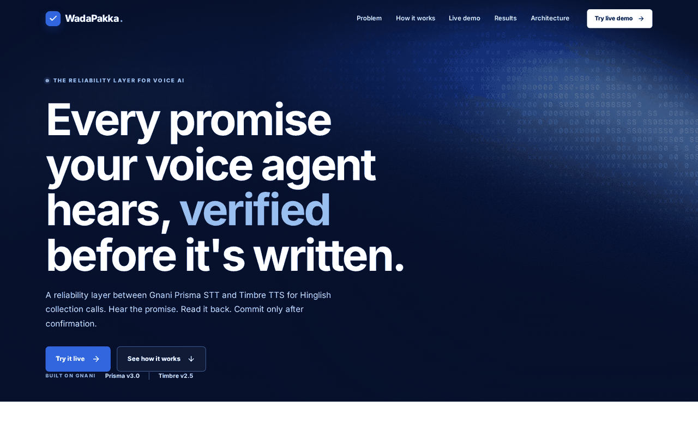
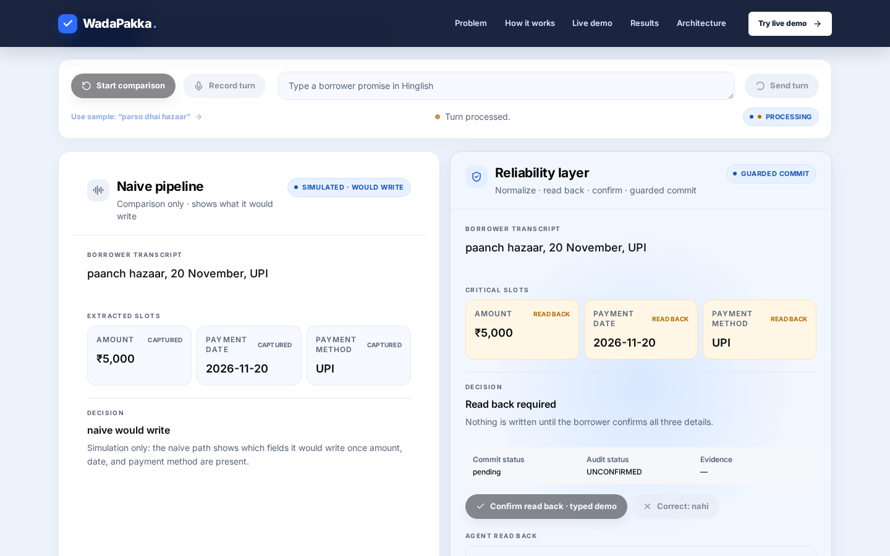
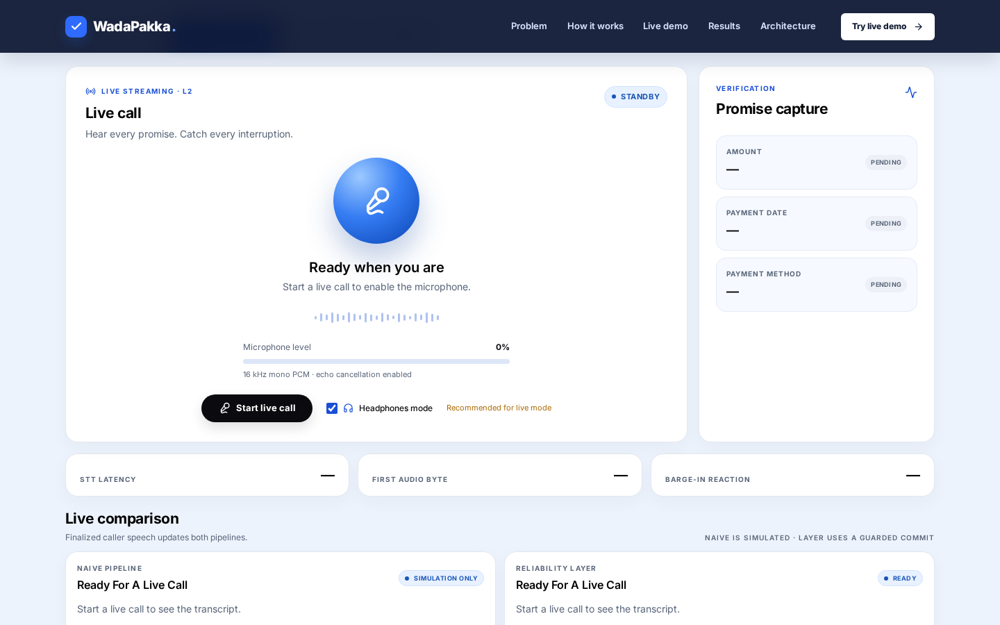
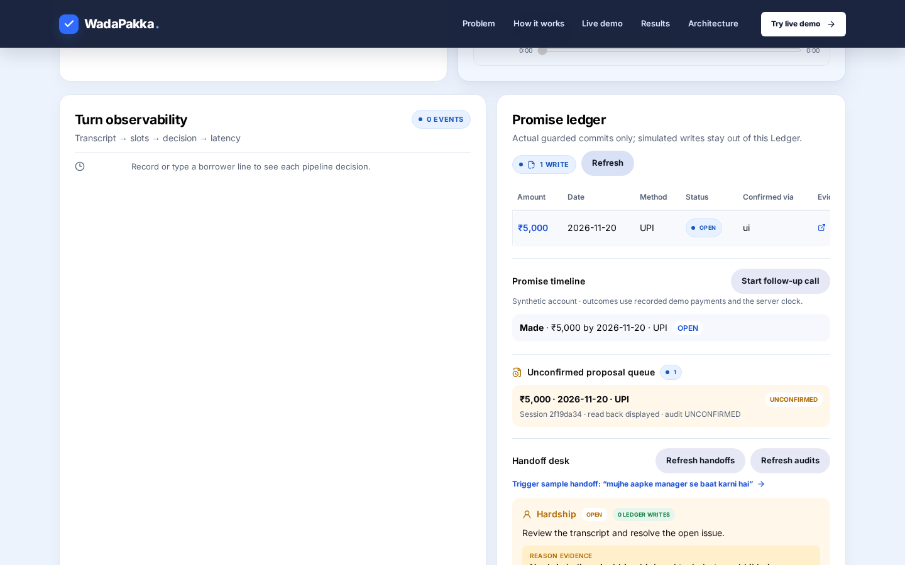
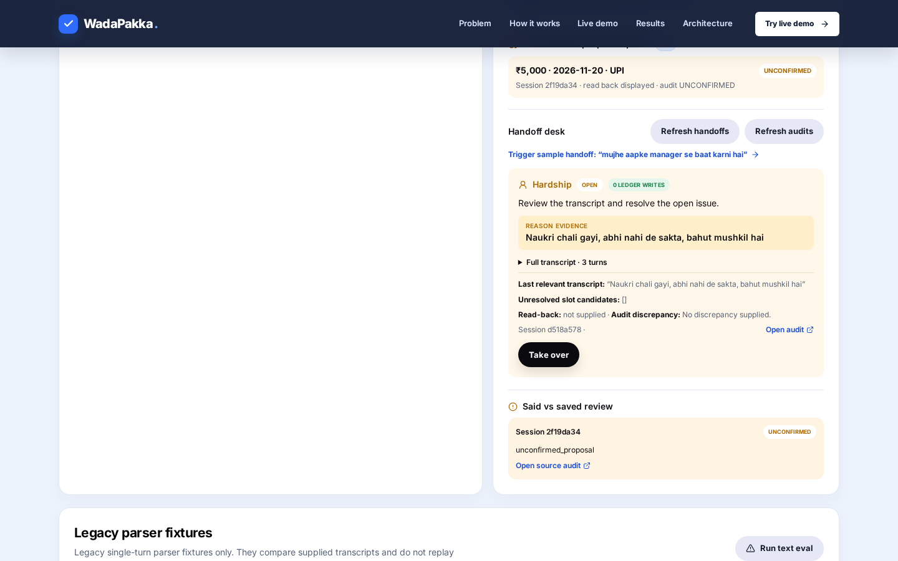
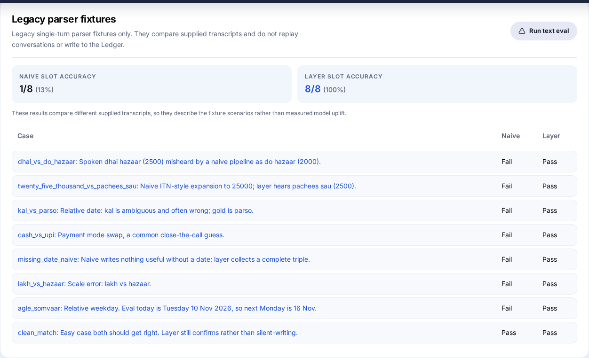
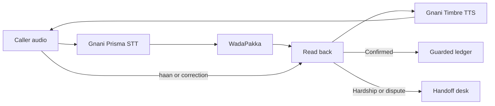

# WadaPakka

A reliability layer for Hinglish promise-to-pay collection calls.

WadaPakka sits between Gnani Prisma STT and Timbre TTS. It reads back every promise, commits only on a clear "haan", and hands hardship calls to a human. It ships as a Python SDK that lenders can drop into an existing collection bot.

**Live demo:** [https://wadapakka.vercel.app](https://wadapakka.vercel.app)

A walkthrough and a short trailer are in `demo/`.

## Screenshots



*The live product homepage.*



*L1 turn panel: the naive path would write immediately; the layer waits for a read-back and "haan".*



*L2 live streaming call, with promise capture and barge-in controls.*



*Guarded ledger: only confirmed promises are saved, with a timeline and unconfirmed queue.*



*Handoff desk for hardship and dispute calls, including the triggering transcript and takeover.*



*Fixture evaluation: naive parser vs the reliability layer.*

## Features

- Normalizes Hinglish amounts, dates, and payment modes
- Reads every proposed promise back before a write
- Commits only on an explicit "haan"; retries are idempotent
- One open promise per account, with a said-vs-saved audit trail
- Hands hardship, dispute, and wrong-person calls to a human desk
- Remembers promises across calls (kept, changed, or broken)
- Python SDK, REST API, and signed webhooks for existing voice stacks

## How it works



Speech is transcribed, slots are normalized, and the proposal is spoken back. A ledger write happens only after a clear yes. If the caller signals hardship or a dispute, the session moves to a human.

## SDK quick start

```python
from wadapakka import Layer, LenderConfig, InMemoryStore

layer = Layer(config=LenderConfig(), store=InMemoryStore())

decision = layer.on_turn("call-1", "synthetic-ravi-kumar", "paanch hazaar, 20 November, UPI")
# decision.action == "readback"; speak decision.say via your TTS

decision = layer.on_turn("call-1", "synthetic-ravi-kumar", "haan")
# decision.action == "commit"; decision.audit has the said-vs-saved trail

layer.confirm("call-1", yes=True)   # button or DTMF-style confirmation
layer.commit("call-1")              # idempotent; will not force a write
```

`on_turn` returns a `Decision` with `action` (`readback`, `wait`, `commit`, `handoff`, `noop`), `say`, `proposal`, and `audit`. Install the package from this repository. See `docs/SDK.md` and `examples/quickstart.py` for Pipecat, LiveKit, and telephony adapters.

## Run locally

Requirements: Python 3.11, Node 22, ffmpeg, and a Gnani API key for voice features. Text fixtures and typed turns run without the key.

```sh
python3 -m venv .venv
.venv/bin/pip install -r requirements.txt
cd web && npm ci && npm run build && cd ..
cp .env.example .env
# Add GNANI_API_KEY to .env for audio — never commit .env
.venv/bin/uvicorn app:app --host 127.0.0.1 --port 8000
```

Then open the app on port 8000. The demo includes turn-based and live streaming views, fixture evaluation, a ledger, and a handoff desk.

## Tests

```sh
.venv/bin/pytest -q
```

63 pytest tests. Evaluation: 13/13, 4/4, 2/2, and 4/4 across the adversarial conversation suites.

## Project structure

```
wadapakka/     Python SDK (Layer, LenderConfig, stores, adapters)
app.py         FastAPI demo server
web/           React demo UI
docs/          SDK docs and product screenshots
examples/      Offline quickstart, Pipecat, LiveKit, telephony
tests/         pytest
demo/          Walkthrough and trailer videos
```

## References

Gnani Prisma STT, Gnani Timbre TTS, Pipecat, LiveKit, and Remotion.

## Contributing

See `CONTRIBUTING.md` for setup, tests, and the project rules.

## License

MIT, as declared in `pyproject.toml`.
