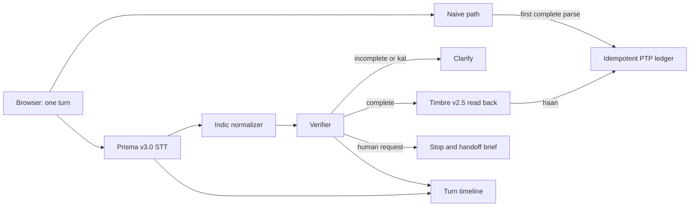

# WadaPakka reliability layer

WadaPakka is a demo middleware layer for a synthetic collections call. It turns Gnani Prisma speech transcripts into a promise to pay only after normalizing Hinglish/Indic amount and date phrases, reading the amount, date and payment mode back with Gnani Timbre, and receiving an explicit confirmation. The split screen gives the *same borrower turn* to a naive first guess pipeline and the guarded pipeline; the ledger, handoff brief and per-turn timeline show the difference. No real borrower data is used.

## Run

```bash
python3 -m venv .venv
.venv/bin/pip install -r requirements.txt
cp .env.example .env
# Set GNANI_API_KEY in .env for mic turns and spoken prompts.
.venv/bin/uvicorn app:app --port 8000
```

Open [http://127.0.0.1:8000](http://127.0.0.1:8000). `ffmpeg` must be on PATH for browser WebM mic clips; typed turns and the text eval work without it or an API key. Click **Start comparison**, then type a synthetic line such as `main parso dhai hazaar rupaye UPI se de dunga` or record a turn. The same audio blob is sent to both pipelines. Confirm the layer's spoken read back with **Confirm: haan**. Say or type `insaan se baat karao` for a human handoff.

The key is loaded from `.env` with `python-dotenv`. `.env` is ignored by Git. Calls go only to `https://api.vachana.ai` using `X-API-Key-ID`; Agent Builder/Inya is not used.

## Architecture



Prisma REST (`POST /stt/v3`) is used with `model=prisma-v3.0`, `format=transcribe`, `language_code=hi-IN,en-IN`. Timbre REST (`POST /api/v1/tts/inference`) uses `model=timbre-v2.5`, voice `Poorvi`, language `hi-en`, 16 kHz mono WAV. Prisma REST has no usable confidence field, so every critical slot requires read back. Optional `format=verbatim` dual pass can flag disagreement, but agreement is an application signal, not model confidence. The browser records turns, not a full duplex stream.

## Evaluation

```bash
.venv/bin/python eval.py                 # deterministic text fixtures
.venv/bin/python eval.py --audio         # live Timbre-generated WAV -> Prisma
.venv/bin/python -m pytest -q
```

`GET /api/eval` runs the same eight text fixtures. Those fixtures deliberately give the naive and layer paths *different supplied transcripts*, so their 1/8 versus 8/8 result is a scenario comparison, **not** measured model uplift. The live audio eval feeds the same three synthetic lines through Timbre and Prisma. Its last observed exact triple accuracy was **2/3 for both parsers before borrower confirmation**; the layer made **zero unconfirmed writes**. See [eval results](docs/eval_results.md) for case data and interpretation. Generated WAV clips are in `docs/audio/`.

## API

| Route | Purpose |
| --- | --- |
| `POST /api/session` | Start fictional account session |
| `POST /api/turn-text` | Process typed turn |
| `POST /api/turn` | Upload mic audio; convert WebM with ffmpeg |
| `POST /api/confirm` | Confirm or reject read back |
| `GET /api/session/{id}` | Session and turn log |
| `GET /api/ledger` | In-memory idempotent PTP rows |
| `GET /api/eval` | Text fixture result |
| `GET /api/tts?text=` | Timbre WAV |
| `GET /health` | Liveness and key presence |

## Limits

The ledger and sessions are in memory and reset on restart; production needs durable, transactional storage, authentication, retention controls and account scoped idempotency. The parser handles a defined set of Indic/Hinglish phrases and can miss or misinterpret new wording. Prisma can substitute a plausible wrong number; read back lowers silent write risk but only a real borrower can verify it. The generated audio eval is tiny, clean, synthetic and nondeterministic across STT calls. No real borrower, noisy channel or human confirmation accuracy has been measured. The demo is turn based REST, so barge in stops the next turn, not current TTS playback. `kal` is held for clarification because it can refer to either yesterday or tomorrow.
