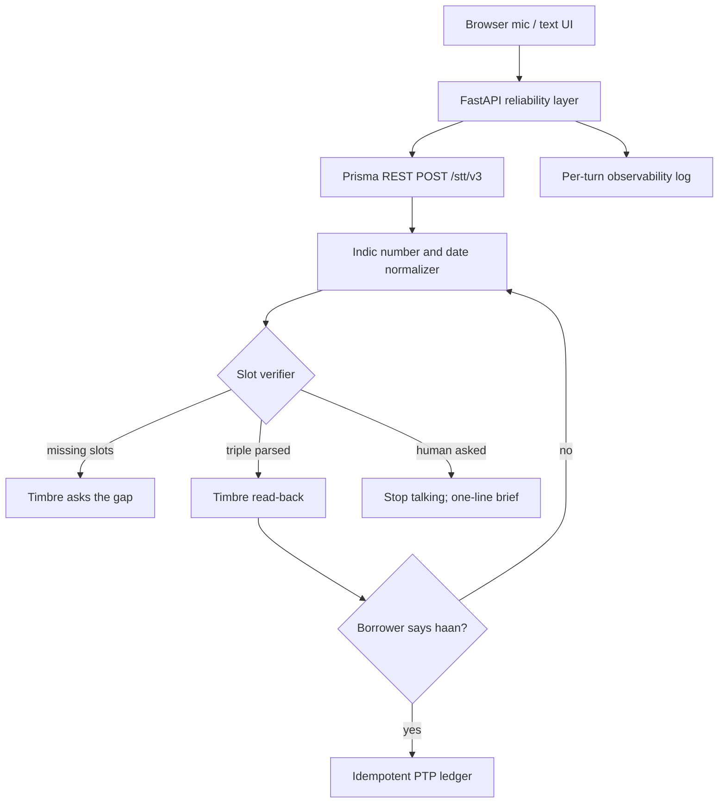
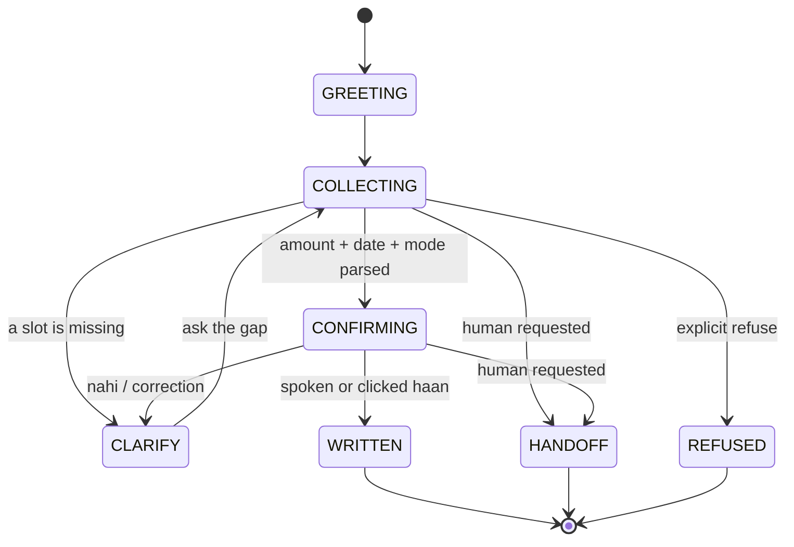

# WadaPakka reliability layer

A middleware layer between Gnani Prisma STT (and Timbre TTS) and the agent's business logic. The demo use case is **WadaPakka**, a promise-to-pay closer for collections.

This does not change Gnani's models. It sits in front of them: normalise Indic/Hinglish amounts and dates, refuse to write a critical slot until the borrower hears it read back, write at most one PTP row for a retry, and hand off to a human with a one-line brief.

Prisma does **not** expose a usable ASR confidence score for applications. The "confidence-aware" behaviour in this repo is therefore confirm-by-default on amount, date and payment mode, plus an optional dual-pass (`format=transcribe` vs `format=verbatim`) agreement check. That is an application policy, not a Prisma feature. See [Verified API capabilities](#verified-api-capabilities).

The official challenge FAQ puts Agent Builder / Inya out of scope. This project talks only to `https://api.vachana.ai` with header `X-API-Key-ID`.

Synthetic data only. The demo account is fictional. Do not put real phone numbers, account numbers, Aadhaar, PAN or recorded borrower calls into this app.

## Run it

```bash
cd gnani-reliability-layer
python3 -m venv .venv && source .venv/bin/activate
pip install -r requirements.txt
cp .env.example .env   # then export GNANI_API_KEY if you have one
export GNANI_API_KEY="..."    # optional for text turns and /api/eval
uvicorn app:app --reload --port 8000
```

Open http://127.0.0.1:8000

- Text turns and `GET /api/eval` work without a key.
- Live mic turns call `POST https://api.vachana.ai/stt/v3`.
- Spoken agent lines call `POST https://api.vachana.ai/api/v1/tts/inference`. If the key is missing, the UI still shows the prompt as text.

Browser `MediaRecorder` usually produces WebM. The REST docs list WAV, MP3, OGG, FLAC, AAC and M4A, so `app.py` converts other containers to 16 kHz mono WAV with `ffmpeg` before upload.

## Architecture



Tonight's shippable path is **turn-taking over REST**, not full-duplex streaming. A browser cannot set the `x-vad-*` or `x-api-key-id` headers Prisma streaming needs (the docs say to proxy those). The official Python SDK also does not expose VAD tuning. Streaming remains a later upgrade: proxy PCM frames through this backend, listen for `speech_start` / `processing`, and stop Timbre playback on barge-in.

No extra LLM is required for the MVP. Intent and slots are deterministic (`normalizer.py` + `slots.py`). An optional hosted LLM can be added later if parsing gets messy; do not depend on Evon for tonight.

### Modules

| File | Role |
| --- | --- |
| `app.py` | FastAPI routes, naive vs layer modes, session store |
| `gnani_stt.py` | Prisma REST client (`X-API-Key-ID`, `GNANI_API_KEY`) and optional dual-pass |
| `gnani_tts.py` | Timbre REST inference client |
| `normalizer.py` | `dhai hazaar`, `parso`, `agle somvaar`, UPI/cash/bank |
| `slots.py` | Extract amount, date, mode, optional 10-digit phone |
| `verifier.py` | Trust policy (confirm-by-default; optional dual-pass agreement) |
| `state_machine.py` | GREETING → COLLECTING → CONFIRMING → WRITTEN, plus CLARIFY / HANDOFF / REFUSED |
| `idempotency.py` | SHA-256 commit key so a retry cannot insert a second row |
| `handoff.py` | Phrase detection and one-line desk brief |
| `observability.py` | Per-turn transcript, decisions, latency |
| `static/index.html` | Mic + typed turns, naive/layer toggle, eval button |
| `fixtures/eval_cases.json` | Synthetic Hinglish slot-accuracy cases |

### Data flow per turn

1. UI records a clip (or a typed transcript) and posts it with `mode=naive` or `mode=layer`.
2. Layer path: Prisma REST `model=prisma-v3.0`, `language_code=hi-IN,en-IN`, `format=transcribe`, plus domain `keyterms`. Optional second pass with `format=verbatim`.
3. Handoff phrases (`insaan`, `agent se baat`, …) move the session to `HANDOFF` and return a one-line brief. No further TTS after that decision except a single closing line.
4. The normalizer parses amount, relative date and mode.
5. The verifier marks every critical slot as needing confirmation (Prisma has no usable confidence).
6. Timbre reads the parsed triple back. `haan` writes one ledger row; `nahi` returns to collecting; a repeated confirm is a no-op duplicate.
7. The turn is appended to the session log: transcript, STT metadata, decision, latency. The `confidence` field in that log is explicitly `null`.

Naive mode uses the same parser but writes the first complete triple with no read-back. That is the before/after contrast, not a recommended production path.

### Slot confirmation state machine



## Verified API capabilities

Checked against the live docs on 10 November 2026 (Asia/Calcutta). Auth for every Speech API: header `X-API-Key-ID`. The SDK env var is `GNANI_API_KEY` (this repo uses the same name).

### Prisma REST — `POST https://api.vachana.ai/stt/v3`

Multipart fields include `audio_file` (required), `language_code` (required except `format=transliterate` on v3.0), `model` (`prisma-v3.0` or omit for `prisma-v2.5`), `format` (`verbatim`, `transcribe`, plus `codemix` / `transliterate` on v3.0), `keyterms`, `topic`, `previous_text`, `speaker_names` (v3.0), `itn_native_numerals` (v2.5 + `format=transcribe`), `enable_substitution` / `substitution_map`, and v2.5 `bias_list` / `bias_score`.

Supported upload formats on this page: WAV, MP3, OGG, FLAC, AAC, M4A. Maximum duration: 30 seconds.

**There is no `confidence` field, no n-best list, no word timestamps, and no speaker id on REST.**

Documented 200 body for Prisma v3.0:

```json
{
  "success": true,
  "request_id": "5c1f0a52-6d62-4e0b-9a38-2f2b8a8f7a10",
  "transcript": "मेरा खाता नंबर 12345 है",
  "model": "prisma-v3.0",
  "detected_language_code": "hi-IN",
  "processing_time": 0.62,
  "end_to_end_latency": 0.71
}
```

Also documented: `truncated` (only when the token limit cut the transcript; `false` is never sent), and Prisma v2.5 `output.literal` (text before ITN). Audio shorter than 0.1 s returns `success`, `request_id` and an empty `transcript` with no `model` or timings.

Latency notes from the same page: `processing_time` is seconds after the upload was parsed; `end_to_end_latency` includes upload. Prisma v3.0 can return HTTP 504 `UPSTREAM_TIMEOUT` if the transcription step exceeds 5000 ms (`code: "UPSTREAM_TIMEOUT"`). Very short utterances (under about a second) are called the least reliable. Identical audio can differ by a borderline word.

Languages (both models): `bn-IN`, `en-IN`, `gu-IN`, `hi-IN`, `kn-IN`, `ml-IN`, `mr-IN`, `pa-IN`, `ta-IN`, `te-IN`. Prisma v3.0 also accepts `indic-auto` or a comma-separated list of 1–4 codes.

Source: https://docs.gnani.ai/api/STT/speech-to-text

### Prisma realtime — `WSS wss://api.vachana.ai/stt/v3/stream`

Configuration is sent as WebSocket upgrade headers (`x-api-key-id`, `language_code`, `model`, `format`, `x-sample-rate`, VAD knobs, context fields). Audio is raw PCM signed 16-bit little-endian mono, **exactly 1024-byte frames**, paced in real time (32 ms at 16 kHz). Session cap: 15 minutes (then `error` and close code `1001`). Default idle timeout: 60 s (`x-idle-timeout-sec` 5–900).

VAD headers: `x-vad-threshold` (default 0.7), `x-min-silence-ms` (default 500; this is the main end-of-utterance latency lever), `x-min-speech-ms`, `x-min-segment-ms`, `x-max-speech-s`. The docs warn that a browser `WebSocket` cannot set custom headers — proxy through your backend. The Python SDK does not currently expose VAD tuning.

Server message `type` values: `connected`, `processing`, `transcript`, `speech_start`, `error`, `settings_updated`.

`processing` is emitted when VAD detects **end of speech** and transcription has begun:

```json
{
  "type": "processing",
  "timestamp": "2024-01-15T10:30:05.123Z"
}
```

Documented `transcript` sample and fields:

```json
{
  "type": "transcript",
  "timestamp": "2024-01-15T10:30:05.987Z",
  "text": "Hello, how are you today?",
  "audio_duration_ms": 2340,
  "segment_id": "<segment_id>",
  "segment_index": 1,
  "latency": 320
}
```

Also documented on every transcript: `utterance_id`, and `is_final` which is **always `true`**. There are no interim / partial transcripts. Prisma v3.0 may add `detected_language_code`. Prisma v2.5 may add `output.literal` when number formatting ran. `latency` is milliseconds to transcribe that segment. `audio_duration_ms` is the captured speech length, not a word timestamp.

**No confidence field, no n-best, no word-level timestamps, no `speaker_id`.** Diarization is not available on streaming.

`speech_start` is documented as “sent when voice is detected”; on Prisma v3.0 it also carries `utterance_id`. The docs page does not paste a full `speech_start` JSON example (unverified payload).

Client JSON frames: `{"type": "update_settings", ...}` and `{"type": "commit"}` (close the open utterance immediately instead of waiting for silence).

Source: https://docs.gnani.ai/api/STT/stt-websocket

### Prisma batch — jobs, then `GET /stt/v3/batch/jobs/{job_id}/files`

Create (`POST /stt/v3/batch/jobs`) does not start work; you must `POST .../start`. Diarization (`with_diarization`) and `with_denoise` are batch-only. Files can be hours long (docs: up to 4 hours / file on the batch introduction).

`GET .../files` returns `transcript_url` (pre-signed, expires in 1 hour), not the text. The downloaded JSON includes `full_transcript` and `segments[]`.

Official Prisma v2.5 segment objects include `segment_id`, `start_time`, `end_time`, `text`, `speaker_id`, `confidence`, `language_detected`, `sentiment`, `emotion`. **In the official sample every `confidence` (and `sentiment` / `emotion`) is `null`.**

Official Prisma v3.0 sample: the same keys, `confidence` still `null`, and `language_detected` filled per segment that has text (`"hi-IN"`, `"en-IN"`, or `null` on empty segments). A v3 document may also include `engine` (sample: `"go-batch-asr"`).

```json
{
  "segment_id": 0,
  "start_time": 0.42,
  "end_time": 6.18,
  "text": "नमस्ते, मैं HDFC Bank से बात कर रहा हूँ",
  "speaker_id": 0,
  "confidence": null,
  "language_detected": "hi-IN"
}
```

These are **segment** timestamps, not word timestamps.

Sources: https://docs.gnani.ai/api/STTBatch/Introduction and https://docs.gnani.ai/api/STTBatch/Get_Job_Files

### Fallback, stated plainly

Because REST and streaming do not return confidence, n-best, or word-level scores, and because official batch samples show `confidence: null`:

1. Treat every critical slot (amount, date, payment mode; name and phone if collected) as untrusted until the borrower confirms a targeted Timbre read-back.
2. Optionally run two REST passes (`transcribe` vs `verbatim`) and compare the normalised values. Agreement is a signal this layer invents; it is not Prisma n-best.
3. Run the Indic normalizer's plausibility checks (positive amount, `kal` flagged as ambiguous, known mode).
4. Do not invent a numeric confidence from Prisma fields that are absent or null.

An LLM entity-plausibility check is optional and not required for the demo.

### Timbre TTS

| Surface | Endpoint | What you get |
| --- | --- | --- |
| REST | `POST https://api.vachana.ai/api/v1/tts/inference` | HTTP 200 raw audio bytes (`audio/wav`, `audio/mpeg`, `audio/ogg`, …) |
| SSE | `POST https://api.vachana.ai/api/v1/tts/sse` | `event: start`, then `chunk` with base64 `audio` and `is_final: false`, then `complete` with `is_final: true` |
| Realtime | `WSS wss://api.vachana.ai/api/v1/tts` | JSON synthesis request after connect; server streams base64 audio, then a final `is_final: true` message |

Request fields (REST / SSE / the WebSocket JSON body): `text`, `voice`, `model` (`timbre-v2.5` or `timbre-v3.0`), `language`, `speed`, `audio_config` (`sample_rate`, `num_channels`, `sample_width`, `encoding`, `container`, optional `bitrate`).

`speed`: numeric `0.85`–`1.15`, or `"slow"` / `"medium"` / `"fast"`.

Languages: `auto`, `hi-IN`, `en-IN`, `ta-IN`, `te-IN`, `kn-IN`, `ml-IN`, `mr-IN`, `pa-IN`, `bn-IN`, `gu-IN`, `hi-en` (Hinglish).

Voices are per model and are not interchangeable. Timbre v2.5 has 42 voices (examples: `Nalini`, `Kaveri`, `Deepak`, `Poorvi` for Hinglish). Timbre v3.0 has 13 voices that each speak all 10 languages: `Avinash`, `Shivani`, `Lakshmi`, `Kalpana`, `Shubham`, `Prakash`, `Devansh`, `Yashraj`, `Chetana`, `Vasudha`, `Riyaa`, `Tarika`, `Harshad`.

Timbre v3.0 expressive controls are **inline audio tags** in `text`, not SSML: `<coughs>`, `<excited>`, `<exhales>`, `<giggle>`, `<laugh>`, `<pauses>`, `<shouting>`, `<sigh>`, `<slow>`, `<sniffles>`, `<whispers>`, `<yawns>`, `<clears throat>`. On v2.5 those tags are stripped and not spoken; text that is only tags is rejected with 400.

This skeleton uses REST inference with `timbre-v2.5`, voice `Poorvi`, `language=hi-en`, `speed=1.0`. Always send `model` explicitly — the SDK still defaults to deprecated `timbre-v2.0` if you omit it.

Sources: https://docs.gnani.ai/api/TTS/tts-inference, https://docs.gnani.ai/api/TTS/tts-sse, https://docs.gnani.ai/api/TTS/tts-websocket, https://docs.gnani.ai/api/TTS/available-voices

## HTTP API

| Method | Path | Purpose |
| --- | --- | --- |
| `POST` | `/api/session` | Start a synthetic collections session |
| `POST` | `/api/turn` | Multipart audio turn (`session_id`, `mode`, `audio`, optional `dual_pass_flag`) |
| `POST` | `/api/turn-text` | Same logic with a typed transcript (no API key) |
| `POST` | `/api/confirm` | Button shortcut for haan / nahi |
| `GET` | `/api/session/{id}` | Session plus turn log |
| `GET` | `/api/ledger` | Idempotent PTP rows |
| `GET` | `/api/eval` | Naive vs layer slot accuracy on `fixtures/eval_cases.json` |
| `GET` | `/api/tts?text=` | Timbre WAV (requires `GNANI_API_KEY`) |
| `GET` | `/health` | Liveness and whether a key is set |

## Judge metric

`GET /api/eval` scores eight synthetic Hinglish transcripts (not live borrower audio). Naive writes the first parsed triple. The layer parses with the Indic normalizer and only scores a hit if it would ask for confirmation and the parsed triple matches gold.

As of this skeleton the expected contrast is low naive accuracy (misheard `do hazaar` vs `dhai hazaar`, `twenty five thousand` vs `pachees sau`, `kal` vs `parso`, cash vs UPI, missing date, lakh vs hazaar, bare `sunday` vs `agle somvaar`) against a high layer score on the correctly heard transcripts, without silent writes.

Replace the text fixtures with noisy recorded clips once a key exists if you want an audio-level number. Keep every clip synthetic.

## What was not verified

- No live call was made to `api.vachana.ai` from this skeleton (no key was present). Field names and samples are from the docs pages cited above.
- Whether a production batch job ever fills `segments[].confidence` with a number. Official samples are `null`.
- The full JSON body of `speech_start` (the streaming page describes it but does not paste an example).
- n-best / alternative transcripts — not documented on REST, streaming or batch pages reviewed.
- Word-level timestamps or per-word confidence — not present in any documented response schema reviewed.
- SSML: the inference, SSE and WebSocket TTS pages document speed and Timbre v3.0 audio tags, not SSML. This repo does not send SSML.
- Whether a browser WebM upload would be accepted without conversion. The REST page lists WAV, MP3, OGG, FLAC, AAC, M4A only.
- HTTP 402 “insufficient credit” is noted in the docs as not fully verified there.
- Interim streaming transcripts other than `is_final: true` — the docs say `is_final` is always true on a `transcript`.

## Challenge notes

Working app on at least one Gnani model or API; public LinkedIn/X demo with `#GnaniAI` and `#GreatIndianAIInternshipChallenge` before submit; synthetic data only; Agent Builder / Inya out of scope. See the project Page for the hour-by-hour plan, demo script and post draft.
