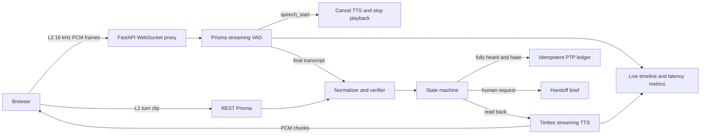

# WadaPakka reliability layer

WadaPakka is a demo middleware layer for a synthetic collections call. It turns Gnani Prisma speech transcripts into a promise to pay only after normalizing Hinglish/Indic amount and date phrases, reading the amount, date and payment mode back with Gnani Timbre, and receiving an explicit confirmation. The split screen gives the *same borrower turn* to a naive first guess pipeline and the guarded pipeline; the ledger, handoff brief and per-turn timeline show the difference. No real borrower data is used.

## Run

```bash
python3 -m venv .venv
.venv/bin/pip install -r requirements.txt
cp .env.example .env
# Set GNANI_API_KEY in .env for mic turns and spoken prompts.
.venv/bin/uvicorn app:app --port 8000
```

Open [http://127.0.0.1:8000](http://127.0.0.1:8000). `ffmpeg` must be on PATH for browser WebM mic clips; typed turns and the text eval work without it or an API key. Click **Start comparison**, then type a synthetic line such as `main parso dhai hazaar rupaye UPI se de dunga` or record a turn. The same audio blob is sent to both pipelines. Confirm the layer's spoken read back with **Confirm: haan**. Say or type `insaan se baat karao` for a human handoff.

The key is loaded from `.env` with `python-dotenv`. `.env` is ignored by Git. Calls go only to `https://api.vachana.ai` using `X-API-Key-ID`; Agent Builder/Inya is not used.

## Architecture



Prisma REST (`POST /stt/v3`) is used for L1 with `model=prisma-v3.0`, `format=transcribe`, `language_code=hi-IN,en-IN`. Timbre REST (`POST /api/v1/tts/inference`) uses `model=timbre-v2.5`, voice `Poorvi`, language `hi-en`, 16 kHz mono WAV. Prisma REST has no usable confidence field, so every critical slot requires read back. Optional `format=verbatim` dual pass can flag disagreement, but agreement is an application signal, not model confidence.

## Layer 2: live streaming and barge-in

Run the server on port **8001** to keep the existing port 8000 L1 process free:

```bash
.venv/bin/pip install -r requirements.txt
.venv/bin/uvicorn app:app --port 8001
```

Open [http://127.0.0.1:8001](http://127.0.0.1:8001), choose **Live streaming (L2)**, then **Start live call** and allow microphone access. The browser AudioWorklet resamples microphone audio to 16 kHz mono 16-bit PCM and sends 1,024 byte frames at real-time cadence. The backend attaches the secret key and VAD headers to Prisma. Timbre WebSocket audio chunks are played as they arrive; REST inference is a fallback. Echo cancellation and noise suppression are requested from the browser.

To demo barge-in, start talking while the agent reads the amount/date/mode back. Local energy first ducks playback to 30%; only 300 ms of sustained above-threshold energy or Prisma `speech_start` cancels Timbre. The first 500 ms calibrate room noise, playback level raises the threshold, and the first 400 ms of each agent utterance have a local VAD grace window. Headphones mode is on by default. The live timeline marks the agent turn interrupted. If read back was interrupted, saying **haan** cannot write the promise. The agent repeats the read back; wait until it finishes, then say **haan** to confirm. Say **insaan se baat karni hai**, **agent do**, or **manager** for a human handoff and a one-line brief.

The stats bar shows speech end → final STT, speech end → first TTS audio byte, and barge-in reaction. These are per-turn observations, averaged in the bar. The browser timeline reports local playback stop time. The stats bar uses server-reported signal-to-TTS-cancellation time, labeled by its source in the timeline; these measurements use different clocks.

A real scripted run on 10 November 2026 streamed `docs/audio/dhai_hazaar.wav` through port 8001 at 32 ms/frame. It returned `मैं परसों 2,500 रुपये यू पी आई से दे दूंगा।`: **707, 714, and 755 ms** from speech end to final STT; **1,142, 1,049, and 1,269 ms** from speech end to first TTS audio byte; Prisma reported **156, 144, and 145 ms** STT latency. These are three runs of one clean generated clip, not a distribution or mic/barge-in benchmark. Reproduce with:

```bash
.venv/bin/python scripts/stream_smoke.py docs/audio/dhai_hazaar.wav
```

The live endpoint accepted only `language_code=hi-IN` in this run although the documentation describes a comma-separated v3 list. [Wire details and source links](docs/api_notes.md) record that discrepancy.

## Evaluation

```bash
.venv/bin/python eval.py                 # deterministic text fixtures
.venv/bin/python eval.py --audio         # live Timbre-generated WAV -> Prisma
.venv/bin/python -m pytest -q
```

`GET /api/eval` runs the same eight text fixtures. Those fixtures deliberately give the naive and layer paths *different supplied transcripts*, so their 1/8 versus 8/8 result is a scenario comparison, **not** measured model uplift. The live audio eval feeds the same three synthetic lines through Timbre and Prisma. Its last observed exact triple accuracy was **2/3 for both parsers before borrower confirmation**; the layer made **zero unconfirmed writes**. See [eval results](docs/eval_results.md) for case data and interpretation. Generated WAV clips are in `docs/audio/`.

## API

| Route | Purpose |
| --- | --- |
| `POST /api/session` | Start fictional account session |
| `POST /api/turn-text` | Process typed turn |
| `POST /api/turn` | Upload mic audio; convert WebM with ffmpeg |
| `POST /api/confirm` | Confirm or reject read back |
| `GET /api/session/{id}` | Session and turn log |
| `GET /api/ledger` | In-memory idempotent PTP rows |
| `GET /api/eval` | Text fixture result |
| `GET /api/tts?text=` | Timbre WAV |
| `GET /health` | Liveness and key presence |
| `WS /api/live/{session_id}` | L2 PCM, events, TTS audio and cancellation |

## Limits

The ledger and sessions are in memory and reset on restart; production needs durable, transactional storage, authentication, retention controls and account scoped idempotency. The parser handles a defined set of Indic/Hinglish phrases and can miss or misinterpret new wording. Prisma can substitute a plausible wrong number; read back lowers silent write risk but only a real borrower can verify it. The generated audio eval is tiny, clean, synthetic and nondeterministic across STT calls. No real borrower, noisy channel or human confirmation accuracy has been measured. L2 is a local demo proxy; it has no authentication or durable session store. Prisma speech_start can still reflect acoustic leakage in an uncontrolled room. The scripted barge-in run is synthetic and does not measure a real mic or speaker. `kal` is held for clarification because it can refer to either yesterday or tomorrow.

## UI and barge-in verification (10 November 2026)

The original static interface added a live call stage, status pill, mic orb and meter, slot state cards, stats, and a collapsible newest-first event timeline. It remains as the fallback when the React build is absent.

On port 8001, `scripts/stream_smoke.py docs/audio/dhai_hazaar.wav` reported 698 ms speech-end to final STT and 1,011 ms speech-end to first TTS byte. `scripts/barge_smoke.py docs/audio/dhai_hazaar.wav` received agent TTS, injected the caller WAV 450 ms into its playback, and observed Prisma cancellation 266 ms after caller WAV onset; server speech-start to cancellation rounded to 0 ms. Use `--audible` to play streamed agent PCM via ffplay during this test. These are single scripted observations, not a real microphone benchmark.

## React frontend

The interface now lives in `web/` (Vite, React, TypeScript, Tailwind CSS, Radix-style button primitives, Framer Motion and Lucide icons). FastAPI serves `web/dist` at `/` when it has been built and falls back to the former `static/index.html` when the build is absent. The previous page remains available at `/static/index.html`. The backend REST and WebSocket contracts are unchanged.

For development, run FastAPI on port 8001 and Vite separately:

```bash
.venv/bin/uvicorn app:app --port 8001
cd web
npm install
npm run dev
```

Open the Vite URL printed by the command. Its `/api` proxy forwards REST and WebSocket traffic to port 8001. For a built page, run `npm run build` in `web/`, then start or restart FastAPI on port 8001 and open `http://127.0.0.1:8001`.

The React design adapts three published component patterns: [21st.dev Spotlight Card](https://21st.dev/@jahed/components/spotlight-card) for pointer-responsive surface emphasis, [BoardUI Meter](https://www.boardui.com/components/meter) for a labeled level rail, and [Opensource UI Now Playing Bar](https://opensourceui.in/components/now-playing-bar) for compact audio information and controls. These are original adaptations; no source from the component pages was copied. L1 and L2 call logic is wrapped in React hooks, and the AudioWorklet and barge VAD algorithms are retained from the static implementation.

Verification on 10 November 2026: `npm run build` completed with no TypeScript errors; `.venv/bin/pytest -q` passed 10 tests. A port-8001 typed-turn smoke check produced a naive write, a layer read back, and a confirmed write. `scripts/stream_smoke.py` received a Prisma transcript and first Timbre audio byte on the port-8001 WebSocket. A headless Playwright page check could not launch Chrome in this sandbox, so visual layout and real microphone behavior remain unverified here.
