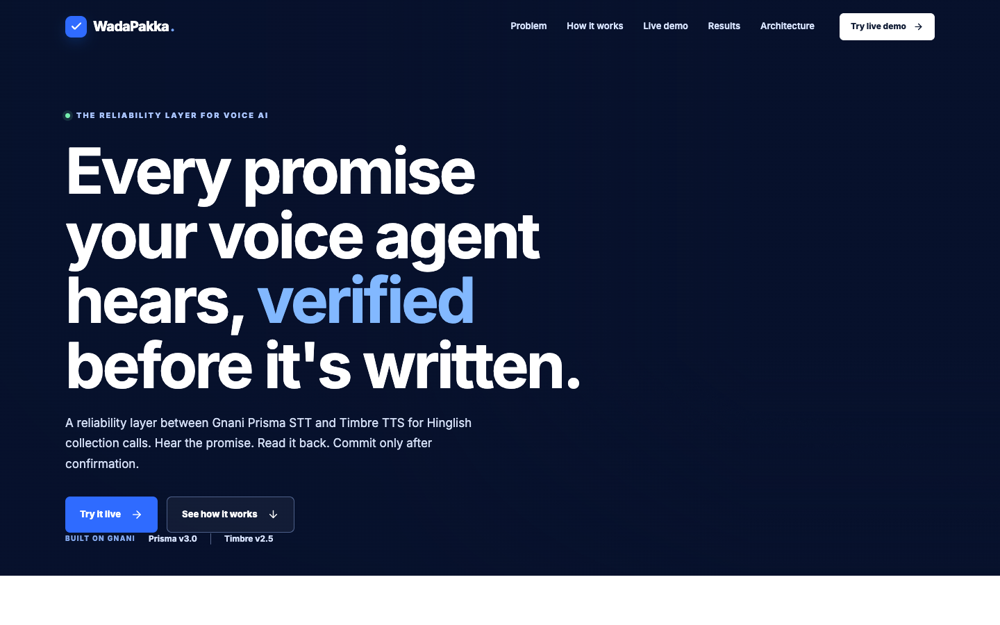
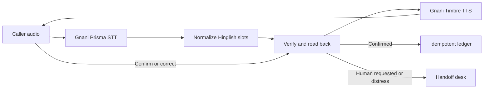

# WadaPakka

A reliability layer between Gnani Prisma STT and Timbre TTS for Hinglish promise-to-pay calls. It turns speech into a proposed amount, date, and payment method; reads the proposal back; and writes to the ledger only after confirmation.

**Live demo:** https://adapters-alternate-carrying-wool.trycloudflare.com (temporary tunnel; requires the local server to remain running). For a persistent deployment, use the [Render blueprint](https://render.com/deploy?repo=https://github.com/Thesilentprogramer/wadapakka) and set `GNANI_API_KEY` in Render.



## The problem

Hinglish collection calls mix numbers, relative dates, English payment terms, and corrections. A plausible STT transcript can contain the wrong amount. A voice agent that writes the first parseable triple can therefore record an unconfirmed promise.

## Architecture



L1 uses REST STT with turn based audio; WebM is converted to WAV with ffmpeg. L2 uses WebSocket streaming with interruption handling. The FastAPI server keeps the Gnani key out of the browser and serves the built React app.

## Measured results

The [evaluation notes](docs/eval_results.md) report eight hand authored text fixtures: naive **1/8 (12.5%)**, layer **8/8 (100%)** exact triples. Seven cases use different supplied transcripts, so this is a fixture demonstration, not measured STT improvement. In three clean synthetic audio cases, both parsers scored **2/3 (66.7%)** before borrower confirmation; the layer made **0 unconfirmed writes**. One Prisma substitution rendered ₹325 as ₹3,500.

The [API notes](docs/api_notes.md) record scripted streaming checks on one generated clip: **698–755 ms** from speech end to final STT, **1,011–1,269 ms** to first TTS byte, and one **266 ms** injected audio barge in reaction. These are smoke observations, not production latency benchmarks.

## Run locally

Requirements: Python 3.11, Node 22, ffmpeg, and a Gnani API key for voice features. Text fixtures and typed turns can run without the key.

```sh
python3 -m venv .venv
.venv/bin/pip install -r requirements.txt
cd web && npm ci && npm run build && cd ..
cp .env.example .env
# Add GNANI_API_KEY to .env for audio
.venv/bin/uvicorn app:app --host 127.0.0.1 --port 8000
```

Open http://127.0.0.1:8000. The demo has turn based and live streaming comparisons, a case by case fixture evaluation, a ledger, and a session handoff desk. Run checks with `.venv/bin/pytest -q` and `cd web && npm run build`.

## Deploy

The `Dockerfile` builds the React app and installs ffmpeg. `render.yaml` defines a free Render web service with `GNANI_API_KEY` entered during setup. Server state is in memory, so sessions, ledger rows, and handoffs reset on restart.
## Reliability v2

The synthetic demo now freezes each proposed amount, date, and payment mode before a full read-back and clear confirmation. A guarded SQLite Ledger allows one open promise per synthetic account across sessions; the naive comparison only shows what it *would* have written. Each saved promise links to transcript evidence with character offsets, and the audit compares heard, proposed, and saved values. `/api/eval/adversarial` replays eight isolated synthetic conversations; `/api/eval` remains a legacy parser fixture demonstration. Live Prisma/Timbre behavior is a separate optional smoke check, and the in-memory session and audit desk reset on restart.
